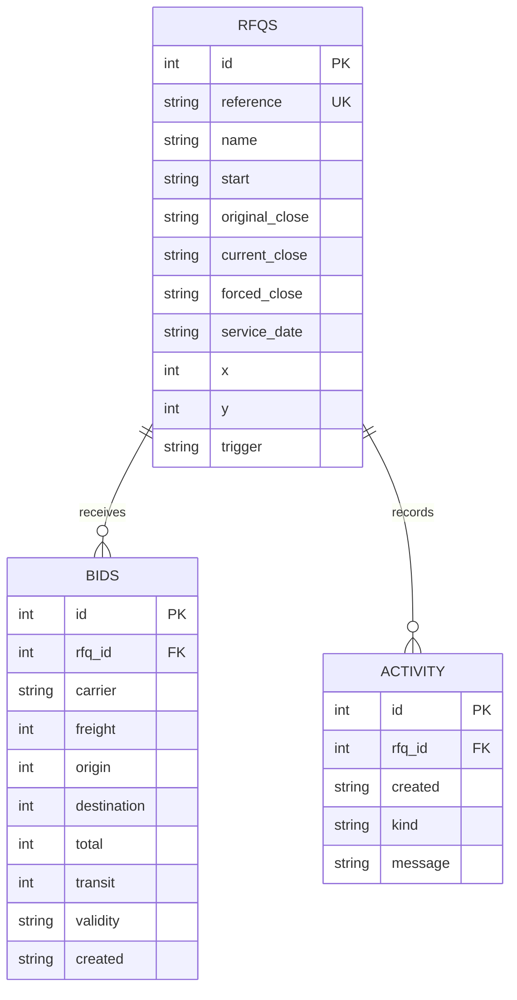

# Database schema

RFQS stores configuration and mutable closing time. BIDS is append-only; carrier name is the demo supplier identifier (case insensitive). All charges and totals are integer paise; transit is days. ACTIVITY stores creation, accepted bids and extensions including reason and old/new close. All dates are UTC ISO 8601 strings. Indexes: bids(rfq_id, carrier, id), activity(rfq_id,id); reference is unique. Foreign keys enforced on each connection. Actual executable DDL is in backend/main.py. Rank and status are derived, not duplicated.
