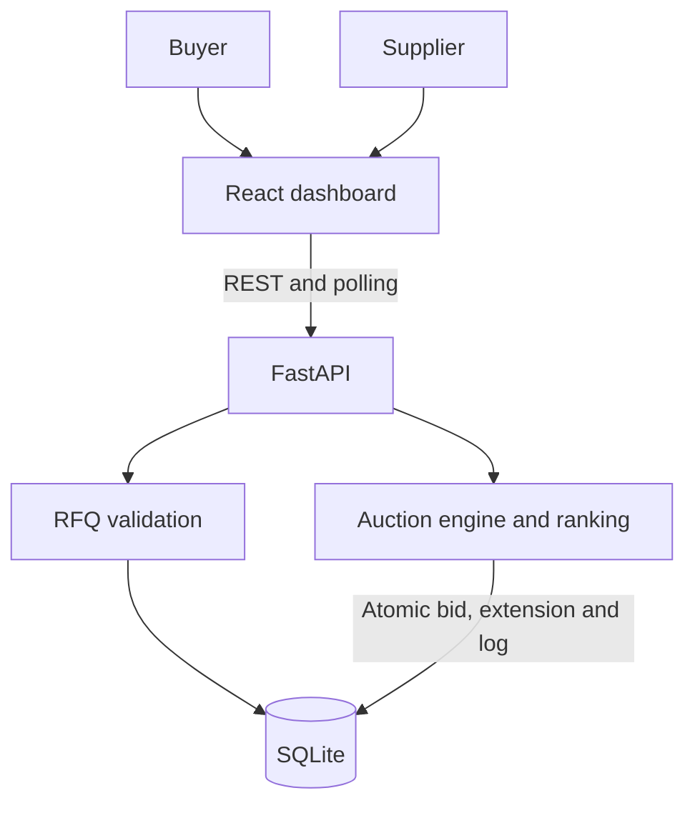
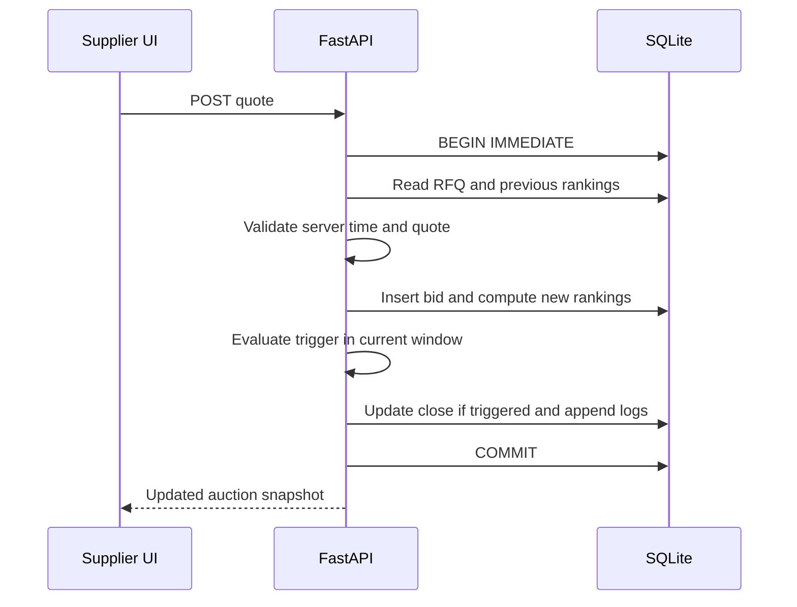

# High-level design
## Architecture

## Bid sequence

Reject invalid bids before insertion; rollback on failure. SQLite serializes writers, preventing concurrent extensions from overwriting one another. Reads use transactions for consistent snapshots. Money uses integer minor units. Time is normalized to UTC. Polling refreshes rankings and status without sockets. For larger scale migrate to PostgreSQL row locks and push updates via SSE/WebSocket. Success metrics: bids per RFQ and final price improvement against comparable non-extended auctions; no improvement is claimed without observed data.
